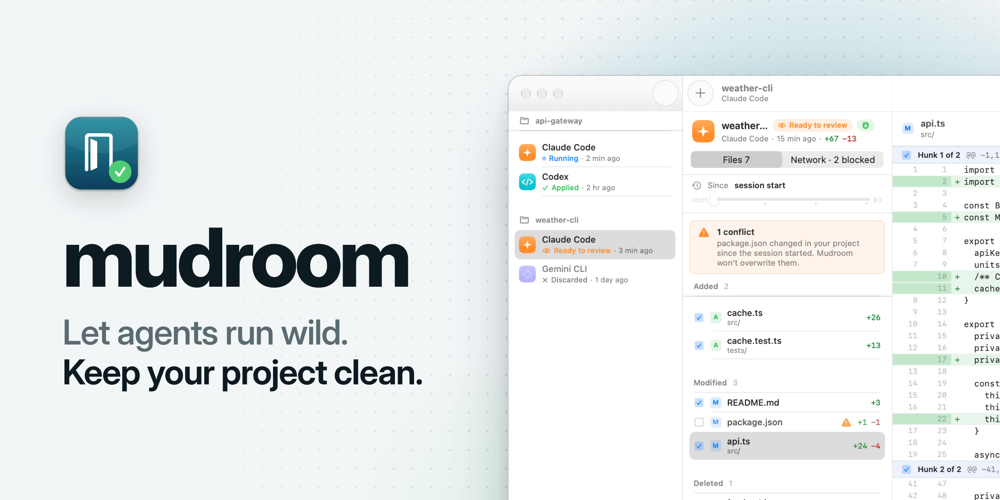
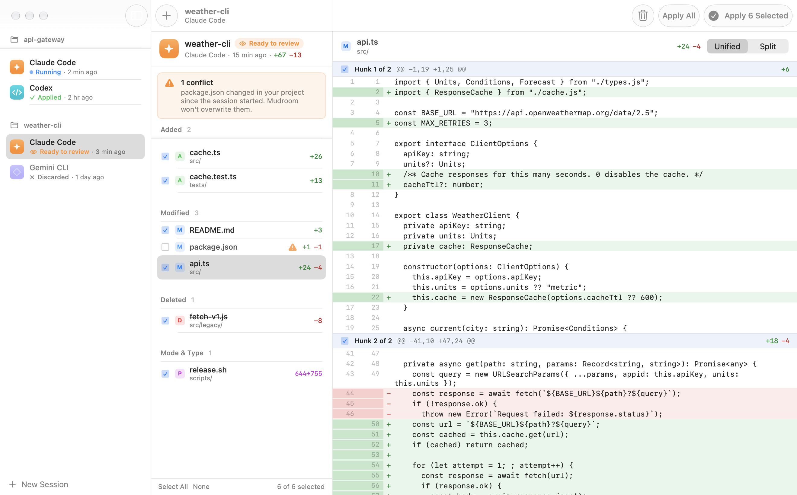
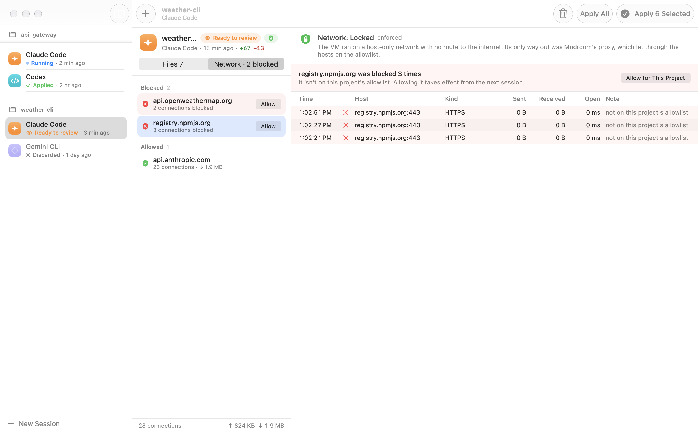
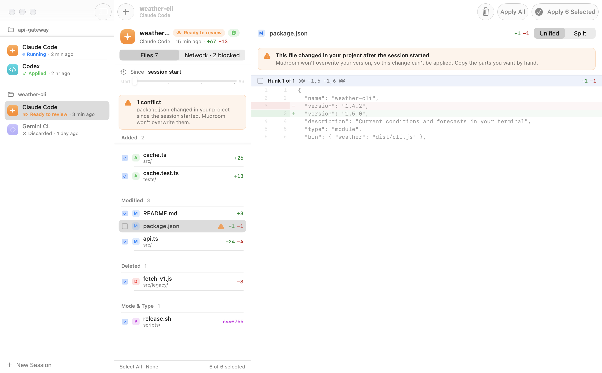
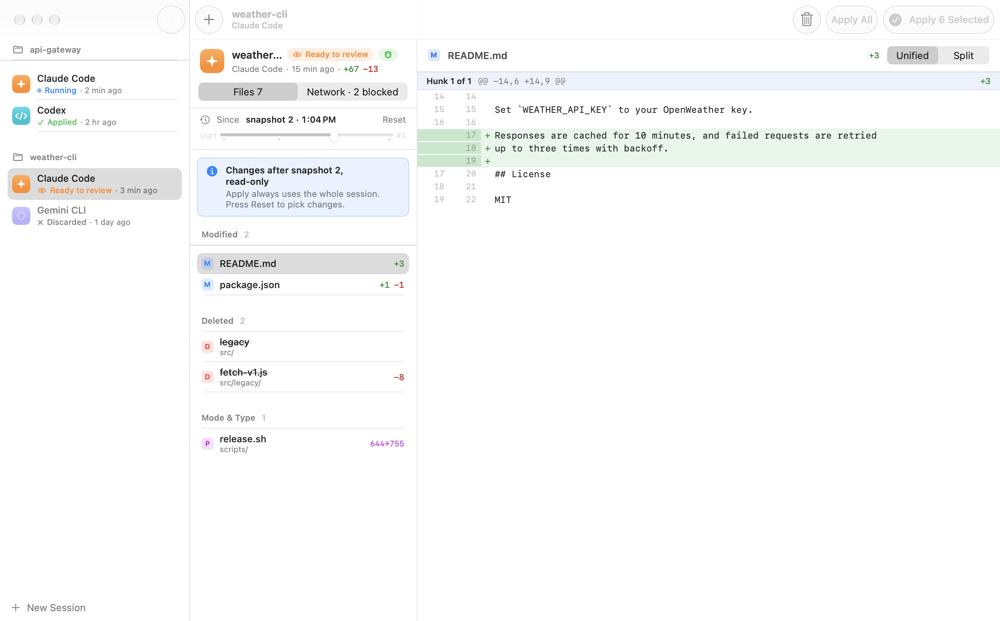
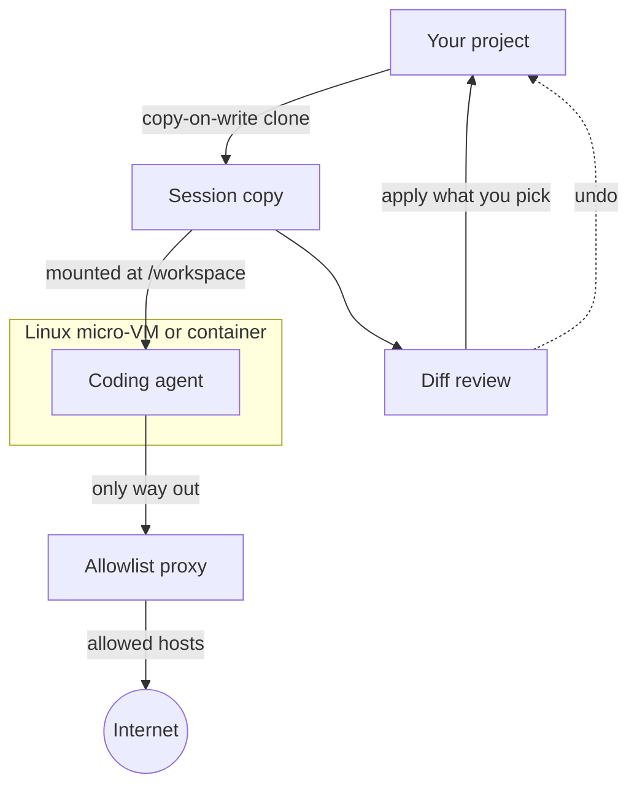
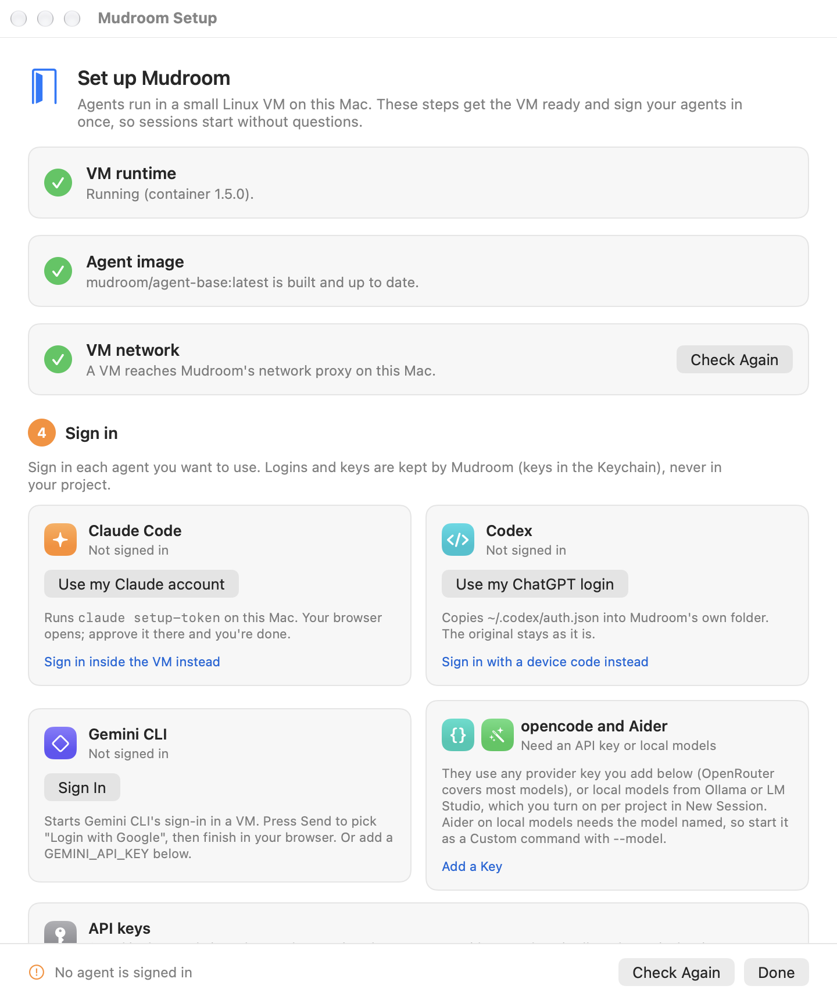
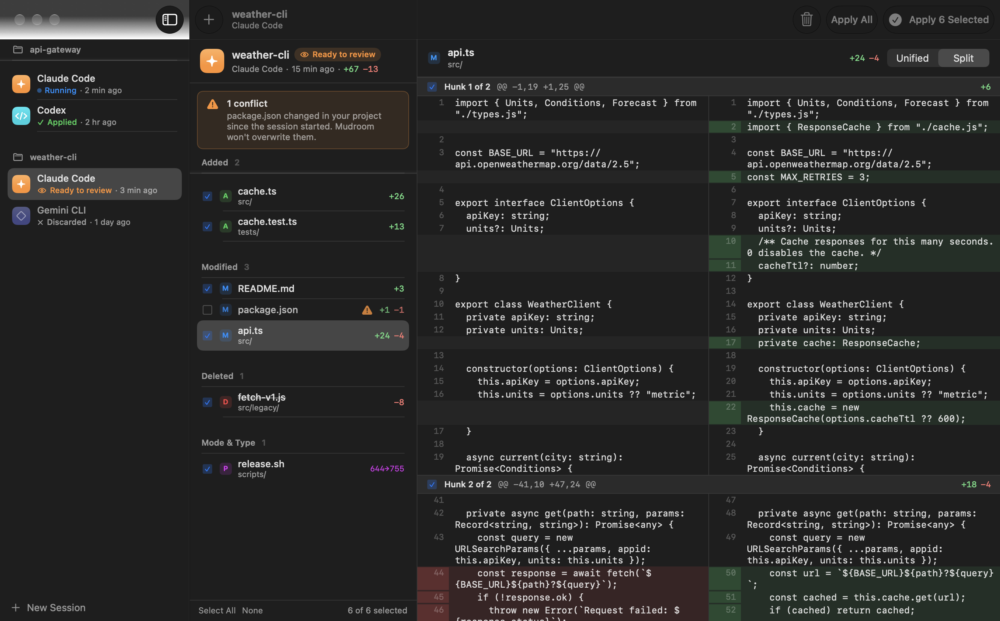
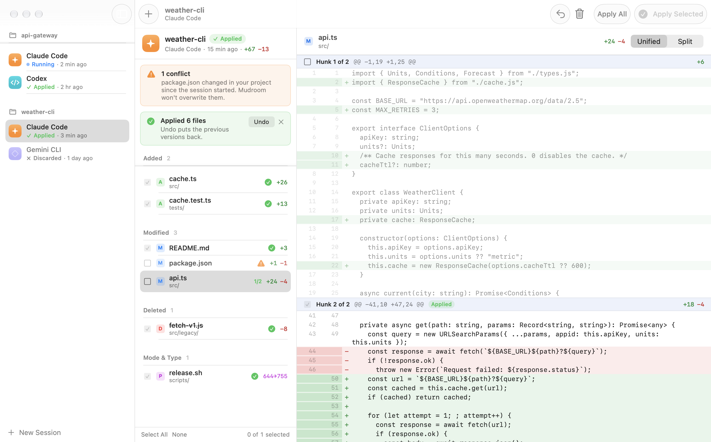
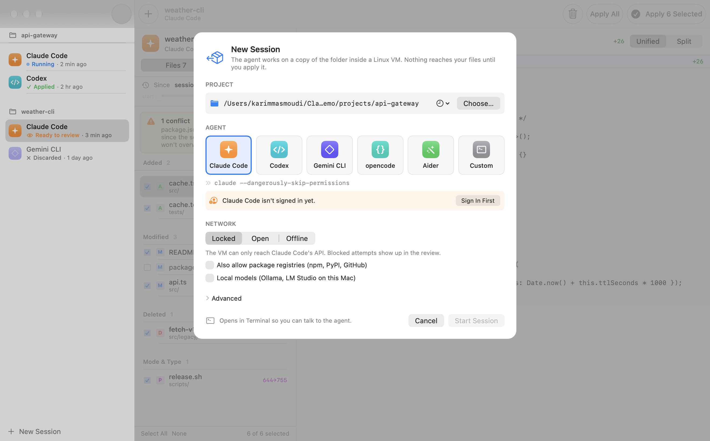

<picture>
  <source media="(prefers-color-scheme: dark)" srcset="docs/assets/mudroom-banner-dark.png">
  
</picture>

<p align="center">
  <a href="#install">Install</a> ·
  <a href="https://kernel-hunter.github.io/mudroom/">Website</a> ·
  <a href="#contents">Docs</a> ·
  <a href="#how-it-compares">How it compares</a> ·
  <a href="https://github.com/Kernel-Hunter/mudroom/releases">Releases</a>
</p>

<p align="center">
  <a href="LICENSE"></a>
  <a href="https://github.com/Kernel-Hunter/mudroom/releases/latest"></a>
</p>

**Mudroom** runs coding agents like Claude Code, Codex, Gemini CLI, opencode
and Aider (or any command) on a clone of your project, inside a Linux
micro-VM, with network access limited to the hosts you allow. When the agent
is done, you review its changes like a pull request, apply all of it, some
files, some hunks or none, and undo any apply later. It's a free, local
alternative to cloud agent sandboxes, and your real folder is never mounted.

https://github.com/user-attachments/assets/ff599cbc-fbd9-4c8f-801d-fd2e52ccb0c6

<p align="center"><sub>33 seconds, with sound: the agent edits a clone in a VM, reaches only the hosts you allow, and you apply what you pick.</sub></p>

> **Status:** early prototype. Expect rough edges and breaking changes.

## Install

The Mac app and CLI run on Apple-silicon Macs with macOS 26 or later. On
Linux, Windows and Intel Macs, Mudroom is a CLI that uses Docker or Podman.

### macOS

With Homebrew, which also installs Apple's `container` CLI:

```sh
brew install --cask kernel-hunter/tap/mudroom
```

Or with the install script:

```sh
curl -fsSL https://raw.githubusercontent.com/Kernel-Hunter/mudroom/main/install.sh | sh
```

<details>
<summary><b>What the install script does, and how to uninstall</b></summary>

<br>

The script needs macOS 26 or later on Apple silicon. It downloads the latest
release, checks its SHA-256 when the release publishes one, puts Mudroom.app
in /Applications (or ~/Applications if /Applications isn't writable) and
links the `mudroom` command into /opt/homebrew/bin, /usr/local/bin or
~/.local/bin. It doesn't use sudo. Set `MUDROOM_VERSION=0.1.1` to pick a
version. To remove Mudroom (your sessions and settings stay):

```sh
curl -fsSL https://raw.githubusercontent.com/Kernel-Hunter/mudroom/main/install.sh | sh -s -- --uninstall
```

</details>

<details>
<summary><b>About signing and Gatekeeper</b></summary>

<br>

Mudroom is ad-hoc signed, not notarized. The install script and the Homebrew
cask remove the quarantine flag, so macOS opens it. If you download the zip
in a browser, use System Settings > Privacy & Security > Open Anyway, or run
`xattr -dr com.apple.quarantine /Applications/Mudroom.app`.

</details>

On an Intel Mac, the CLI works with Docker or Podman; [build it from
source](#build-from-source).

### Install on Windows

CLI only, Windows 10/11 on x86_64 or arm64. With [Scoop](https://scoop.sh):

```powershell
scoop bucket add kernel-hunter https://github.com/Kernel-Hunter/scoop-bucket
scoop install mudroom
```

Then install a container runtime: [Docker Desktop](https://docs.docker.com/desktop/setup/install/windows-install/)
with the WSL 2 backend (Linux containers, the default), or
[Podman](https://podman.io/docs/installation#windows) with a Podman machine
(`podman machine init`, then `podman machine start`). Build the agent image
once and check the network:

```powershell
mudroom image build --backend docker      # or --backend podman
mudroom network check --backend docker
```

Run `mudroom` from Windows Terminal or any console with VT support. See
[Windows](#windows-1) for what is different from macOS and Linux.

<details>
<summary><b>Without Scoop: install from the release zip</b></summary>

<br>

Each release has a zip for x86_64 and one for arm64:
`mudroom-<version>-windows-x86_64.zip` and `mudroom-<version>-windows-arm64.zip`
on the [Releases](https://github.com/Kernel-Hunter/mudroom/releases/latest)
page, each with a `.sha256`. The zip holds a folder with `mudroom.exe` and
the Swift runtime and Visual C++ DLLs it loads, so Swift doesn't need to be
installed. Keep the files together and put the folder on your PATH (copying
`mudroom.exe` alone won't run without Swift installed). In PowerShell:

```powershell
$v = '0.5.0'; $arch = 'x86_64'          # or 'arm64'
$name = "mudroom-$v-windows-$arch"
Invoke-WebRequest "https://github.com/Kernel-Hunter/mudroom/releases/download/v$v/$name.zip" -OutFile "$env:TEMP\$name.zip"
Get-FileHash "$env:TEMP\$name.zip"     # compare with $name.zip.sha256 on the release page
Expand-Archive "$env:TEMP\$name.zip" $env:TEMP -Force
$dir = "$env:LOCALAPPDATA\Programs\Mudroom"
New-Item -ItemType Directory -Force $dir | Out-Null
Copy-Item "$env:TEMP\$name\*" $dir -Force
# Once: add the folder to your user PATH, then open a new terminal.
[Environment]::SetEnvironmentVariable('Path', [Environment]::GetEnvironmentVariable('Path', 'User') + ";$dir", 'User')
```

To upgrade, run `mudroom update`, or the same lines with the new version
without the PATH line. `mudroom.exe` isn't code-signed; if Windows blocks it after you unzip
with Explorer, run `Get-ChildItem $dir | Unblock-File`.

The Scoop and winget manifests are in [packaging/scoop](packaging/scoop)
and [packaging/winget](packaging/winget). The winget package is waiting for
review in the winget repository, so `winget install` doesn't find it yet.

</details>

### Linux

CLI only, x86_64 and arm64, built from source. You need Swift 6.2 or later
([swift.org/install](https://www.swift.org/install/)) and Docker Engine or
Podman.

<details>
<summary><b>Build and install the CLI</b></summary>

<br>

```sh
git clone https://github.com/Kernel-Hunter/mudroom
cd mudroom
swift build -c release
cp .build/release/mudroom /usr/local/bin/   # or anywhere on your PATH
mudroom image build --backend docker        # or --backend podman, once
mudroom network check --backend docker      # see what the sandbox can reach
```

</details>

### Updating

**Mac app.** Mudroom.app updates itself with
[Sparkle](https://sparkle-project.org): Mudroom > Check for Updates, or
let it check once a day (it asks the second time you open it). Nothing is
installed until you click Install, and Mudroom only installs an update that
is signed with its own key. The `mudroom` command inside the app updates
with it. Mudroom 0.5.0 and older don't have the updater yet, so update
those once by hand: `brew upgrade --cask mudroom`, or run the install script
again.

**Command line.** `mudroom update` checks for a new release and updates
the way Mudroom was installed:

| Installed with | `mudroom update` |
|---|---|
| Homebrew | runs `brew upgrade --cask mudroom` |
| The install script or the zip | opens Mudroom.app's updater |
| A Windows release zip | downloads the new zip, checks its SHA-256 against the release, and swaps the files in |
| Scoop, winget | prints `scoop update mudroom` or `winget upgrade --id KernelHunter.Mudroom --exact` to run (neither can replace `mudroom.exe` while it runs) |
| Built from source | tells you to `git pull` and rebuild |

It asks before changing anything; `--yes` skips the question and `--check`
only checks. In a terminal, Mudroom also prints one line after a command
when a newer release is out, at most once a day:

```text
Mudroom 0.6.0 is available (you have 0.5.0). Run `mudroom update` to get it.
```

<details>
<summary><b>What the update check sends, and how to turn it off</b></summary>

<br>

The CLI makes one request, once a day (an hour later if GitHub couldn't be
reached): `GET
https://api.github.com/repos/Kernel-Hunter/mudroom/releases/latest`, over
HTTPS, with no cookies or credentials. GitHub sees your IP address and a
`User-Agent: mudroom/<version>` header, which its API requires. Nothing
else is sent: no ID, no system details, nothing about your projects or
sessions. The answer is cached in Mudroom's data folder
(`update-check.json`). The check runs on your machine only, never in the
sandbox, and never during `run`, `start` or `agent`, in JSON output, under
CI, or when standard output or standard error isn't a terminal. A slow or
failed check never delays a command by more than a second and never
changes its result.

The Mac app reads its feed, `https://kernel-hunter.github.io/mudroom/appcast.xml`,
once a day if you said yes to automatic checks. Sparkle sends the app's
name and version in its User-Agent and no system profile. The feed and
each update are signed with Mudroom's EdDSA key; an update or feed that
doesn't match the key is refused.

To turn the checks off:

- the CLI: `mudroom update --auto-check off` (saved in Mudroom's
  `settings.json`), or `MUDROOM_NO_UPDATE_CHECK=1` in your environment;
- the app: Mudroom > Settings > Check for updates automatically. The
  `mudroom` command inside the app follows this setting too.

`mudroom update` itself always checks, since you asked it to.

</details>

## Quick start

In the app:

1. Open Mudroom and work through the Setup window: install and start the VM
   runtime, build the agent image (a few minutes, once), and sign in an
   agent.
2. Click New Session, pick a folder and an agent, and start.
3. When the agent finishes, review the diff in Mudroom and apply what you
   want.

From a terminal. On Linux and Windows the same commands use Docker, or
Podman when Docker isn't there; `--backend` picks one.

```sh
# Once: start the VM runtime, build the agent image, sign in an agent
mudroom setup

# Run an agent on a clone of your project
mudroom run ~/code/myapp -- claude --dangerously-skip-permissions

# Read the diff, pick files or hunks, press x to apply
mudroom review last

# See what the agent connected to, and what was blocked
mudroom network log last

# Changed your mind
mudroom undo last
```

## Features

Coding agents work best with permission prompts turned off, and that means
they can delete files or reach any host while you aren't looking. Mudroom
puts a sandbox and a review step between the agent and your project.

- **Your folder stays untouched.** The agent edits a copy-on-write clone
  (APFS, or a reflink on btrfs and XFS), untracked and ignored files
  included, minus `.env` files and keys. Your project is never mounted.
- **A VM per session.** Apple's `container` boots one lightweight Linux VM
  for each session. Docker and Podman work too, with gVisor or Kata if you
  have them.
- **Network allowlist.** Locked by default: no DNS and no route out. The
  only exit is a proxy on your machine that lets through the agent's API
  hosts plus the ones you add.
- **A log of every connection.** In locked mode: host, port, bytes, allowed
  or blocked, and which program in the sandbox opened it
  (`git-remote-https`, `node`, `python3`).
- **Keys stay out.** `.env` files, `*.pem`, SSH keys and `.netrc` are left
  out of the agent's copy by default. Edit the list per project or with a
  `.mudroomignore`.
- **Review like a pull request.** Files grouped by change, unified or
  side-by-side diffs, a checkbox per file and per hunk. Your own edits since
  the start are flagged, never overwritten.
- **Undo and snapshots.** Any apply can be undone in one step, even one
  killed halfway. Snapshots taken every 5 minutes show what changed after
  any point.
- **Any agent, your sign-in.** Five agents set up for you, or any command.
  Sign in with your Claude account, the ChatGPT and Google logins you
  already have, API keys, or local models.

### Pick what to keep, file by file or hunk by hunk

Changed files are grouped into Added, Modified, Deleted and Mode & Type,
each with a checkbox, next to a unified or side-by-side diff. Modified text
files have a checkbox per hunk, so you can take some edits and leave others.

<picture>
  <source media="(prefers-color-scheme: dark)" srcset="docs/screenshots/review-dark.png">
  
</picture>

### See every host the agent tried to reach

The Network tab lists blocked hosts first, with bytes and connection
counts. Allow adds a blocked host to the project's allowlist for the next
session.

<picture>
  <source media="(prefers-color-scheme: dark)" srcset="docs/screenshots/network-dark.png">
  
</picture>

### Your own edits are never overwritten

Files you changed yourself since the session started are flagged in the
list and above the diff. Apply leaves them alone and takes the rest.



### Look back at any point in the run

Snapshots are taken while the agent works. Move the timeline slider and the
file list shows only what changed after that point.



## How it compares

How the usual ways of running an agent differ, in their default setup:

| | Edits reach your folder | Network |
|---|---|---|
| Agent on your machine | Right away | Anything your machine reaches |
| Dev container | Right away | Open by default |
| Cloud sandbox | When you pull them | Depends on the provider |
| **Mudroom** | **When you apply them** | **Allowlist, each connection logged** |

<details>
<summary><b>The full comparison</b></summary>

<br>

**Agent on your machine**

- Where it edits: your real folder, and edits land right away.
- Boundary: your user account, plus the agent's own prompts or sandbox.
- Network: anything your machine reaches, unless the agent's own sandbox
  limits it.
- Review: `git diff`, or per-edit prompts.
- Your code leaves your machine: only what the agent sends.
- Account or bill for the sandbox: none.

**Dev container**

- Where it edits: your folder, usually bind-mounted, and edits land right
  away.
- Boundary: a container (the host's kernel on Linux).
- Network: open by default.
- Review: `git diff`.
- Your code leaves your machine: only what the agent sends.
- Account or bill for the sandbox: none.

**Cloud sandbox**

- Where it edits: a copy on the provider's servers. Edits reach your folder
  when you pull or download them.
- Boundary: the provider's VM or container.
- Network: depends on the provider.
- Review: through git or the provider's tools.
- Your code leaves your machine: yes, it runs remotely.
- Account or bill for the sandbox: a provider account, usually paid by
  usage.

**Mudroom**

- Where it edits: a clone; your folder is never mounted. Edits reach your
  folder when you apply them.
- Boundary: one micro-VM per session, or a container with Docker or Podman.
- Network: allowlist through a proxy (locked mode, the default), each
  connection logged with the command that opened it.
- Review: review app or terminal screen, per file and per hunk, with undo.
- Your code leaves your machine: only what the agent sends to allowed
  hosts.
- Account or bill for the sandbox: none, MIT.

</details>

A dev container gives you a reproducible toolchain, and a cloud sandbox runs
many agents in parallel without using your machine. Mudroom does neither: it
runs on your own computer, the review app needs a Mac with macOS 26, and the
agent image is one general-purpose image unless you pass your own with
`--image`.

### Other agent sandboxes

Checked against each project's docs on 2026-09-30. Corrections welcome.

- **Mudroom.** Linux micro-VM, on an APFS clone; your folder is never
  mounted. The agent's writes reach your folder when you apply them, after
  a diff review per file and per hunk, with undo.
- **[Docker Sandboxes](https://docs.docker.com/ai/sandboxes/security/).**
  A microVM, with your folder mounted read-write by default, or a private
  git clone with `--clone`. Writes reach your folder right away by default;
  with `--clone`, when you fetch. Review goes through git, in clone mode.
- **[Apple's `sandboxy` example](https://github.com/apple/containerization/tree/main/examples/sandboxy).**
  A Linux VM with your folder shared in. Writes land right away, with no
  review step.
- **[ArcBox](https://github.com/arcboxlabs/arcbox/blob/master/docs/agent-sandbox.md).**
  A microVM with nothing mounted. Only what you copy out reaches your
  folder, with no review step.
- **[Claude Code sandboxing](https://code.claude.com/docs/en/sandboxing).**
  Your real folder, with OS-level limits (no VM). Writes land right away,
  with per-edit prompts unless you skip permissions.

If your project is a git repo and you're happy reviewing with git, Docker
Sandboxes' `--clone` mode gets you close. Mudroom also covers untracked and
ignored files and folders that aren't repos, and gives you a review screen
and per-apply undo.

## How it works



1. Mudroom clones the project twice: `base/` is the starting point and `work/`
   is what the agent edits. On APFS the clones take no extra disk until files
   change.
2. The agent runs in its own VM (or container) with only `work/` inside. In
   locked mode its one way out is the proxy, which checks every host against
   the project's allowlist and logs the connection.
3. You review `base/` against `work/` in the app or the terminal and apply
   what you pick. Mudroom checks that each file in your project still matches
   `base/`, so your own edits are never overwritten. Any apply can be undone.

More detail in [Under the hood](#under-the-hood), [Network](#network) and
[Review and apply](#review-and-apply).

<a name="contents"></a>

## Documentation

The rest of this page is the full reference:
[Requirements](#requirements) ·
[Build from source](#build-from-source) ·
[Setup](#setup) ·
[The app](#the-app) ·
[Command line](#command-line) ·
[Agents, sign-in and API keys](#agents-sign-in-and-api-keys) ·
[Keep files out of the sandbox](#keep-files-out-of-the-sandbox) ·
[Network](#network) ·
[Review and apply](#review-and-apply) ·
[Docker and Podman](#docker-and-podman) ·
[Under the hood](#under-the-hood) ·
[Limitations](#limitations) ·
[FAQ](#faq) ·
[Development](#development)

## Requirements

- **macOS 26+, Apple silicon:** app and CLI. Sandbox backend `apple`
  (Apple's `container`, one VM per session), or `docker`/`podman`.
- **macOS 26+, Intel:** CLI only (build from source), with `docker` or
  `podman`.
- **Linux x86_64 and arm64:** CLI only (build from source), with `docker`
  or `podman`.
- **Windows 10/11, x86_64 and arm64:** CLI only ([release
  zip](#install-on-windows) or build from source), with `docker` (Docker
  Desktop) or `podman` (Podman machine).

The `apple` backend needs Apple's [`container`](https://github.com/apple/container)
CLI, version 1.5 or later. Setup installs it with Homebrew if you don't have
it.

The CLI picks a backend with `--backend apple|docker|podman|auto` (or
`MUDROOM_BACKEND`). `auto`, the default, uses Apple's `container` on an
Apple-silicon Mac with macOS 26+ where it is installed, otherwise Docker,
otherwise Podman. A session remembers its backend, so `mudroom start` uses
the same one again. See [Docker and Podman](#docker-and-podman) for how
isolation differs from the VM backend.

### Build from source

You need Xcode 26+ (Swift 6.2+).

```sh
git clone https://github.com/Kernel-Hunter/mudroom
cd mudroom
scripts/build-app.sh            # build/Mudroom.app (app + bundled CLI), ad-hoc signed
open build/Mudroom.app
```

For the command line only (macOS or Linux):

```sh
swift build -c release
cp .build/release/mudroom /usr/local/bin/   # or anywhere on your PATH
```

On Linux you also need Docker Engine or Podman and the agent image; see
[Linux](#linux).

#### Windows

You need Swift 6.2 or later for Windows ([swift.org/install/windows](https://www.swift.org/install/windows/)),
which brings the Visual Studio build tools it needs, and Docker Desktop
(WSL 2 backend, Linux containers) or Podman Desktop with a Podman machine.
In a Developer PowerShell:

```powershell
git clone https://github.com/Kernel-Hunter/mudroom
cd mudroom
swift build -c release -Xcxx -D_ALLOW_COMPILER_AND_STL_VERSION_MISMATCH
copy .build\release\mudroom.exe $env:LOCALAPPDATA\Microsoft\WindowsApps\   # or anywhere on your PATH
mudroom image build --backend docker
```

The `-Xcxx` flag is only needed when your Visual Studio is newer than the
Clang in your Swift toolchain (Visual Studio 2026 with Swift 6.2): the C++
headers then refuse to build swift-crypto's BoringSSL. Run `mudroom` from
Windows Terminal or any console with VT support (Windows 10 1809 or later).
See [Windows](#windows-1) for what is different there.

## Setup

The Setup window opens on the first launch. It has four steps:

1. **VM runtime**: Install runs `brew install container`, and Start starts
   it. The first start also downloads Apple's recommended Linux kernel.
2. **Agent image**: Build creates `mudroom/agent-base:latest` with Node LTS,
   git, ripgrep, nftables and the agent CLIs (Claude Code, Codex, Gemini CLI,
   opencode and Aider). It takes a few minutes and about 1.5 GB the first time.
3. **VM network**: a quick check that a VM reaches Mudroom's network proxy,
   with a Repair button if it doesn't.
4. **Sign in**: "Use my Claude account" opens your browser; approve there and
   you're done. Codex and Gemini CLI can reuse the login you already have on
   this Mac. For opencode and Aider, add a provider API key (OpenRouter works
   for most models).

Setup stays out of the way once everything is green. It's always under
Mudroom > Setup, and the sidebar tells you when a step needs attention. If
the VM runtime stops later (after a reboot, say), starting a session starts
it again.



In a terminal:

```sh
mudroom setup                      # checks each step and asks before each fix
mudroom setup --yes --no-sign-in   # unattended: install, start, build, repair; skip sign-in
mudroom setup --check              # report only, change nothing
```

By hand, the same steps are `brew install container`, `container system start
--enable-kernel-install`, `mudroom image build` and `mudroom agent login
claude`.

## The app

- **Sidebar**: sessions grouped by project, each with its agent, time and
  status (running, ready to review, applied, discarded).
- **New Session** (⌘N): pick a folder, an agent (Claude Code, Codex, Gemini
  CLI, opencode, Aider or a custom command) and a network mode (Locked, Open,
  Offline), then start. Mudroom clones the folder, leaving out `.env` files
  and keys (see [Keep files out of the
  sandbox](#keep-files-out-of-the-sandbox)), and opens the agent in a new
  Terminal window.
- **Review, Files**: changed files grouped into Added, Modified, Deleted and
  Mode & Type, each with a checkbox. The right pane shows a unified or
  side-by-side diff with line numbers. Modified text files have a checkbox per
  hunk, so you can take some edits and leave others.
- **Review, Network**: every host the VM tried to reach, blocked ones first,
  with bytes and connection counts. **Allow** adds a blocked host to the
  project's allowlist for the next session.
- **Timeline**: if the session has snapshots, a slider picks a point in time
  and the file list shows only what changed after it (read-only).
- **Conflicts**: files you changed yourself since the session started are
  flagged in the list and above the diff, and are never overwritten.
- **Apply Selected** (⌘↩), **Apply All** (⇧⌘↩), **Undo** (⌥⌘Z) and
  **Discard** (⌘⌫). Each apply can be undone in one step. Space toggles the
  selected file.

The Network tab, the timeline and conflicts are shown under
[Features](#features).

<details>
<summary><b>More screenshots</b></summary>

<br>

Dark mode, split diff:



After a partial apply:



New session:



</details>

Agents are interactive terminal programs, and you often need to answer them,
so sessions run in Terminal.app instead of a terminal built into Mudroom. The
app writes a small `run.command` into the session folder that runs `mudroom
start <id>` in a login shell (so `PATH` and API keys match your usual shell),
and follows progress through `session.json`, which `mudroom start` keeps up
to date.

The review app is macOS only. Elsewhere, `mudroom review <session>` is a
terminal review screen: toggle files, read diffs, pick single hunks and apply
the selection.

<details>
<summary><b>Keys in <code>mudroom review</code></b></summary>

<br>

- File list: up/down or j/k move, space toggles a file, a toggles all, enter
  opens the file, x applies the selection after a y/N prompt, q quits.
- A modified text file opens as numbered hunks with a checkbox each: j/k or
  up/down move between hunks, space toggles the one under the cursor, a and n
  select all or none of them, b/f page, x applies, q or esc goes back to the
  list. A file with only some hunks selected shows `[~]` in the list, and
  hunks applied earlier show `[=]`.
- Other files (added, deleted, binary, mode or symlink changes, files over
  4 MB) open as a plain diff and are applied whole: up/down scroll, space/b
  page, q back.

</details>

Whole files and selected hunks go into the project in one apply, so one
`mudroom undo` takes all of it back. `mudroom diff`, `hunks` and `apply` do
the same from scripts.

## Command line

```sh
# Start a session: clone the project, boot a VM, run the agent on the clone.
mudroom run ~/code/myapp -- claude --dangerously-skip-permissions

# Review.
mudroom review last             # terminal review: space toggles, enter shows the diff or hunks, x applies
mudroom diff last --stat
mudroom diff last
mudroom network log last        # what the VM connected to, and what was blocked

# Apply everything, only some paths, or only some hunks of one file.
mudroom apply last --all
mudroom apply last src/parser.swift docs/
mudroom hunks last src/parser.swift            # numbered hunks
mudroom apply last src/parser.swift --hunks 1,3

# Changed your mind.
mudroom undo last

# Snapshots taken while the agent ran.
mudroom snapshots last
mudroom diff last --from 2 --to work           # what changed after snapshot 2
mudroom diff last --from 1 --to 3

# Files kept out of the agent's copy (.env and keys by default).
mudroom exclude list
mudroom exclude add secrets/

# Housekeeping.
mudroom list
mudroom stop <session>          # stops a sandbox left running (e.g. mudroom was killed)
mudroom discard <session>       # deletes the session's clones, never the project

# Two-step start (what the app does).
mudroom new ~/code/myapp --agent "Claude Code" -- claude --dangerously-skip-permissions
mudroom start <session>
```

Sessions can be named by full id, a unique prefix, or `last`. `run` and
`start` also take `--network locked|open|offline`, `--allow <host>` (this run
only), `--snapshot-every <minutes>`, `--cpus`, `--memory`, `--backend
apple|docker|podman|auto` and, for Docker and Podman, `--oci-runtime <name>`
(for example `runsc`). If the VM runtime isn't running, `run` and `start`
start it first.

### Network settings

```sh
mudroom network show                          # mode and allowlist for the current directory
mudroom network allow registry.npmjs.org '*.githubusercontent.com'
mudroom network allow pypi.org --session last # the project of a session
mudroom network deny registry.npmjs.org
mudroom network registries on                 # npm, PyPI and GitHub in one go
mudroom network mode offline
mudroom network check                         # boot a VM and try to get out (see below)
```

Settings are per project, in
`~/Library/Application Support/Mudroom/projects/<hash>.json` on macOS,
`~/.local/share/mudroom/projects/<hash>.json` on Linux and
`%LOCALAPPDATA%\Mudroom\projects\<hash>.json` on Windows, outside the project
so the agent can't change them.

## Agents, sign-in and API keys

Sessions never stop to ask you to sign in. Sign each agent in once, in Setup
or from a terminal, and every later session starts signed in. New Session
sends you to Setup when the agent you picked isn't ready, and `mudroom run`
and `mudroom start` refuse to start Claude Code, Codex or Gemini CLI before
it is signed in (add `--sign-in-in-session` to sign in inside the session
instead). Aider needs either a provider key or a model named with `--model`;
without one, the session stops right away with a message instead of waiting
for a sign-in that can't finish inside the VM.

Ways to sign in, per agent:

- **Claude Code:** your Claude account (`claude setup-token` on the Mac), a
  sign-in inside the VM, or `ANTHROPIC_API_KEY`.
- **Codex:** your existing ChatGPT login (`~/.codex/auth.json`), a device
  code, or an OpenAI API key.
- **Gemini CLI:** your existing Google login (`~/.gemini/oauth_creds.json`),
  a sign-in inside the VM, or `GEMINI_API_KEY`.
- **opencode, Aider, custom commands:** any provider API key, or local
  models.

### Claude Code: your Claude account

If the `claude` CLI is installed on your Mac (Mudroom looks on your PATH,
then in `~/.local/bin`, `/opt/homebrew/bin` and `/usr/local/bin`, then on your
login shell's PATH), "Use my Claude account" in Setup, or `mudroom agent
login claude`, runs `claude setup-token` in a terminal of its own. Claude
opens your browser. Once you approve, Mudroom reads the long-lived token from
Claude's output and stores it. You never see or copy it, and Mudroom hides
it from the output it shows. If the page shows a code instead, paste it into
the field in Setup (or the terminal).

```sh
mudroom agent login claude      # the same from a terminal
mudroom agent token claude      # or paste a token you already have (shown as dots)
mudroom agent token claude --clear
```

The token is kept in the macOS Keychain (service
`io.github.kernel-hunter.mudroom`, written with `SecItemAdd`, never through a
command line). On Linux it goes to `~/.local/share/mudroom/agents/<agent>/token`,
mode 0600. On Windows it goes to Credential Manager (a generic credential
named `io.github.kernel-hunter.mudroom/<agent>`). Sessions get it as
`CLAUDE_CODE_OAUTH_TOKEN`. Mudroom also marks
Claude Code's first-run screens (theme, the bypass-permissions notice, folder
trust for `/workspace`) as done in its own copy of Claude's settings, so a
session starts straight at the prompt.

### Codex and Gemini CLI: the login you already have

If `~/.codex/auth.json` or `~/.gemini/oauth_creds.json` exists, "Use my
ChatGPT login" or "Use my Google login" copies it into Mudroom's agent
directory, only when you click. It is a copy: the original isn't changed or
mounted. If you sign in again on the Mac later, import again.

```sh
mudroom agent import codex
mudroom agent import gemini
```

With an OpenAI API key and no ChatGPT login, Codex sessions get the key as
both `OPENAI_API_KEY` and `CODEX_API_KEY` (Codex reads the second one).

### Signing in inside a VM

Without those, the agent signs in inside a VM. In Setup, the device code
(Codex) or the sign-in page (Claude, Gemini) opens for you, and a field takes
the code the page gives you.

```sh
mudroom agent login claude --in-vm   # `claude auth login` in the sandbox
mudroom agent login codex            # `codex login --device-auth`
mudroom agent login gemini           # Gemini CLI's own sign-in screen
mudroom agent status                 # signed in or not, per agent
```

<details>
<summary><b>How the sign-in link gets out of the sandbox</b></summary>

<br>

Copying a sign-in link out of a terminal is fragile: it wraps over several
lines, and losing the end gives errors such as "Invalid
code_challenge_method". So each run sets `BROWSER` in the sandbox to a small
script on a mounted folder, and when the agent tries to open the link,
Mudroom gets it on the host. It checks that the link is an https page on a
known sign-in host (claude.ai, claude.com, platform.claude.com,
console.anthropic.com, auth.openai.com, chatgpt.com, accounts.google.com),
opens it in your browser, copies it to the clipboard and prints it on one
line. Claude Code's link points back to a port inside the sandbox, so
Mudroom swaps the redirect for Claude's own "copy this code" page and leaves
the rest of the request (PKCE challenge, state) unchanged. After signing in,
paste the code back: in Setup into the code field, in a terminal where the
prompt is (the agent's prompt doesn't echo it).

</details>

### Agent config directories

Each agent gets its own config directory,
`~/Library/Application Support/Mudroom/agents/<agent>/home` (Linux:
`~/.local/share/mudroom/agents/<agent>/home`). Your real `~/.claude` (and the
others) is never mounted. A session doesn't mount this directory either: it
gets a copy, `sessions/<id>/agent-home`, at `/home/node/.claude`,
`/home/node/.codex` or `/home/node/.gemini`. When the session ends, only the
sign-in is copied back (`.credentials.json` and the account fields of
`.claude.json` for Claude Code, `auth.json` for Codex, `oauth_creds.json` and
`google_accounts.json` for Gemini). A login made in a session sticks, while
settings, hooks or MCP servers a session adds stay in that session.

### API keys

For opencode, Aider, custom commands, or an API key instead of a
subscription, store provider keys with Mudroom. Setup has a field for each;
from a terminal:

```sh
mudroom keys set OPENROUTER_API_KEY   # paste it; shown as dots
mudroom keys                          # names only, never values
mudroom keys remove OPENROUTER_API_KEY
```

Known names: `ANTHROPIC_API_KEY`, `OPENAI_API_KEY`, `GEMINI_API_KEY`,
`OPENROUTER_API_KEY`, `DEEPSEEK_API_KEY`, `GROQ_API_KEY`, `MISTRAL_API_KEY`,
`TOGETHER_API_KEY`, `FIREWORKS_API_KEY`, `XAI_API_KEY`. Any other
upper-case name works too. Keys live in the Keychain (Linux: 0600 files;
Windows: Credential Manager).

Claude Code, Codex and Gemini CLI get only their own key. opencode, Aider and
custom commands get all of them, and in locked mode the API host of each
provider whose key is set is allowed automatically: openrouter.ai,
api.deepseek.com, api.groq.com, api.mistral.ai, api.together.xyz,
api.fireworks.ai, api.x.ai (plus api.anthropic.com, api.openai.com and
generativelanguage.googleapis.com). When Claude Code has a sign-in token, a
stored `ANTHROPIC_API_KEY` is left out, so Claude doesn't stop to ask which
one to use.

`ANTHROPIC_API_KEY`, `CLAUDE_CODE_OAUTH_TOKEN`, `OPENAI_API_KEY` and
`GEMINI_API_KEY` are also forwarded from your shell when they are set there.

### How secrets reach the sandbox

Tokens and keys are passed by name (`container run --env NAME`, `docker run
--env NAME`), so their values don't show up in the process list or on a
command line. The runtime does write them down while the session runs:

- Apple's `container` stores each running container's configuration,
  environment included, in plain text in a `config.json` with mode 0644 under
  `~/Library/Application Support/com.apple.container/containers/`. Your
  `~/Library` folder is private to your user, but any process running as
  you can read that file while the session is up.
- Docker and Podman show the environment in `docker inspect` / `podman
  inspect` to anyone who can talk to the daemon.

The entry goes away when the session's container is removed at the end of
the session.

Secrets kept in files inside the project, such as a `.env`, are a different
matter: they would be copied along with the rest of the folder. Mudroom
leaves the usual ones out of the agent's copy by default; see [Keep files out
of the sandbox](#keep-files-out-of-the-sandbox).

### Local models (Ollama, LM Studio)

Turn on Local models for a project (New Session, or `mudroom network
local-models on`) and the VM can use Ollama and LM Studio running on your
Mac. They are reached as `http://host.mudroom.internal:11434` (Ollama) and
`http://host.mudroom.internal:1234` (LM Studio) through Mudroom's proxy,
which connects to 127.0.0.1 on those two ports itself. No other port on the
Mac becomes reachable, and nothing else changes about the allowlist.
Sessions get `OLLAMA_HOST`, `OLLAMA_API_BASE` (Aider) and `LM_STUDIO_API_BASE`
pointing there. Local models need locked mode: open and offline sessions
don't go through the proxy.

Aider needs the model named. In the app, pick Custom and enter:

```sh
aider --yes-always --no-auto-commits --model ollama_chat/qwen2.5:7b-instruct
```

opencode needs the provider in its config, for example an `opencode.json` in
the project:

```json
{
  "provider": {
    "ollama": {
      "npm": "@ai-sdk/openai-compatible",
      "options": { "baseURL": "http://host.mudroom.internal:11434/v1" },
      "models": { "qwen2.5:7b-instruct": { "tools": true } }
    }
  }
}
```

and then `opencode run -m ollama/qwen2.5:7b-instruct "..."` (or pick the model
in opencode). Small models often get tool calls wrong; that is the model, not
the sandbox.

## Keep files out of the sandbox

The agent works on a copy of the whole project folder, so a `.env` with real
keys would be in that copy too. Files that match the project's exclude list
are left out of both copies (`base/` and `work/`). The agent never sees them,
`diff` has nothing to show for them, and `apply` can't create, change or
delete them in your project.

Each project starts with `.env`, `.env.*` (but not `.env.example`,
`.env.sample` or `.env.template`), `.envrc`, `*.pem`, `*.key`, `*.p12`,
`*.pfx`, `id_rsa`, `id_dsa`, `id_ecdsa`, `id_ed25519` and `.netrc`. `.npmrc`
isn't on the list, because a project's `.npmrc` usually holds settings rather
than a token; add it if yours has one. `*.key` also catches Keynote files.

Session start says what was left out:

```
session 20261028-143852-24c4  Claude Code on myapp
project /Users/me/code/myapp stays untouched; the agent sees a copy at /workspace
left out of the sandbox: .env, config/server.pem (2 files). Change the list with `mudroom exclude`.
```

The list is on by default because a key the agent can read is a key it can
send to any host you allowed. The cost is that an agent that needs `.env` to
run your tests won't find it. When that happens, take the pattern off the
list for that project (`mudroom exclude remove .env`), let one file back in
with a `!` line (`mudroom exclude add '!.env.test'`), or keep a `.env.example`
with dummy values, which is copied.

```sh
mudroom exclude list                    # the patterns, and what a new session would leave out
mudroom exclude add secrets/ 'config/*.json' .npmrc
mudroom exclude add '!.env.test'        # let one file back in
mudroom exclude remove .env             # defaults can be removed too
mudroom exclude remove --all            # copy everything again
mudroom exclude reset                   # back to the default list
```

Like the network commands, these work on the current directory, or take
`--project <dir>` or `--session <id>`. In the app, New Session has a "Kept out
of the sandbox" section that shows what the chosen folder would leave out
and lets you add and remove patterns.

<details>
<summary><b>Pattern syntax</b></summary>

<br>

Patterns use `.gitignore` syntax, relative to the project root:

- `name` matches a file or folder with that name at any depth. `/name` and
  `dir/name` match from the project root only.
- `secrets/` matches folders (and symlinks) only, and everything inside them.
- `*`, `?` and `[a-z]` match within one name, `**` across folders
  (`**/id_rsa`, `logs/**`, `a/**/b`). Sets take the POSIX classes
  `[:alpha:]`, `[:digit:]`, `[:alnum:]`, `[:upper:]`, `[:lower:]`,
  `[:space:]`, `[:punct:]` and `[:xdigit:]` (`key[[:digit:]].pem`). Since
  case is ignored, `[:upper:]` and `[:lower:]` both match any letter that has
  case. An unknown class is an error.
- `!pattern` lets a file back in. As in git, nothing inside an excluded
  folder can be let back in.
- Lines starting with `#` are comments, and `\` escapes the next character.
- Names are compared without case and after Unicode normalization, so
  `.ENV` is caught too: on a default APFS or NTFS disk it is the same file as
  `.env`. On Windows, trailing dots and spaces are ignored as well.

</details>

A `.mudroomignore` file at the project root, in the same syntax, adds
patterns for everyone who uses the project, and can be committed. It can only
add: a `!` line in it takes back a pattern from the same file, never one from
your list, so a repository can't use it to pull your `.env` into the sandbox.
It must be a regular file (not a symlink), at most 1 MB, with at most 1,000
patterns of at most 1,024 characters each. If it breaks one of these rules,
or has a line that isn't a pattern, Mudroom refuses to create the session
and says why.

The list is read when a session is created and recorded in its
`session.json`. Changing it later affects new sessions only. Diff and apply
use the recorded list, never the agent's copy of `.mudroomignore`. If the
agent writes a file at an excluded path (it creates its own `.env`, say),
`diff` lists it with an `X` and `apply` skips it:

```
M  README.md
X  .env  (on the exclude list; never applied)
```

The app and `mudroom review` show these below the file list and never apply
them. An agent's edit to `.mudroomignore` itself is flagged and starts
unselected, like `.envrc`.

Symlinks are copied as links and never followed. A link named `.env` is left
out, and a link that points at an excluded file (`config.env -> ../.env`) is
copied but finds nothing at the other end.

Two things to know when the project is a git repository:

- An excluded file that git tracks is missing from the agent's copy, so
  inside the sandbox `git status` shows it as deleted, and a `git commit -a`
  by the agent records the deletion. `apply` leaves `.git` alone unless you
  pass `--include-git`, but with it that commit would land in your
  repository's history. Session start prints a warning when git tracks
  any of the files left out.
- If the agent deletes a folder that holds an excluded file in your project
  (`src/` with your `src/.env` in it), apply removes the other files, reports
  the folder as a conflict because it isn't empty on your side, and applies
  the rest. Your `src/.env` stays.

## Network

Each project has a mode:

- **Locked** (default). The VM is attached to a host-only network
  (`container network create --internal`, named `mudroom-hostonly`). It has
  no route to the internet and no DNS. `mudroom start` runs a small HTTP
  proxy on the Mac for as long as the agent runs, and the VM gets
  `HTTP_PROXY`/`HTTPS_PROXY` pointing at it. The proxy handles `CONNECT`
  (HTTPS) and plain HTTP, lets through only allowlisted hosts, and writes one
  line per connection (host, port, allowed or blocked, bytes, duration) to
  the session's `network.jsonl`. With the apple backend, a firewall inside
  the VM also limits it to that one port on the Mac (see [The firewall in
  the VM](#the-firewall-in-the-vm)).
- **Open**. Normal outbound access. Nothing is filtered or logged.
- **Offline**. The host-only network with no proxy: no internet at all, and
  with the apple backend no connections to the Mac either.

The allowlist is the agent's own hosts plus whatever you add:

- **Claude Code:** api.anthropic.com, console.anthropic.com,
  platform.claude.com, claude.ai
- **Codex:** api.openai.com, chatgpt.com, auth.openai.com
- **Gemini CLI:** generativelanguage.googleapis.com,
  cloudcode-pa.googleapis.com, oauth2.googleapis.com, www.googleapis.com
- **opencode:** models.opencode.ai, models.dev (its model catalog), plus the
  API host of each key you set
- **Aider, custom commands:** the API host of each key you set
- **Package registries (off by default):** registry.npmjs.org, pypi.org,
  files.pythonhosted.org, github.com, codeload.github.com,
  `*.githubusercontent.com`

Telemetry and error-reporting hosts are left out; Claude Code runs with
`CLAUDE_CODE_DISABLE_NONESSENTIAL_TRAFFIC=1` so it doesn't try them. Patterns
are exact hosts or `*.suffix`, which matches subdomains but not the bare
domain.

The proxy is strict about what it accepts:

- A host must be a plain DNS name (letters, digits, hyphens, dots) or an IP
  literal. Anything else is refused: NUL bytes, `%`, spaces, user info,
  trailing junk, and numeric forms like `0x7f.1` or `2130706433`. The name it
  checks is the name it connects to.
- After DNS, the address is checked too. An allowed name that resolves to a
  loopback, private (10/8, 172.16/12, 192.168/16, fc00::/7), link-local, CGNAT,
  multicast, VM-network or one of the Mac's own addresses is refused, unless
  that exact address is on the allowlist.
- For plain HTTP, the `Host` header is rewritten to the host that was checked.
- A client gets 10 seconds to send its request head (then 408), the head can
  be at most 32 KB (then 400), and at most 256 connections are open at once
  (then 503).

### Which process made each connection

In locked sessions the network log also says which program in the sandbox
opened each connection:

```
$ mudroom network log last
BLOCKED  example.com:443                              10x  out 0 B in 0 B  by node
allowed  pypi.org:443                                 10x  out 17 KB in 1.2 MB  by python3
allowed  github.com:443                               30x  out 49 KB in 178 KB  by git-remote-https and node

$ mudroom network log last --all
... BLOCKED  CONNECT gitlab.com:443  out 0 B in 0 B  8 ms  [73] git-remote-https https://gitlab.com/gitlab-org/gitla...  (not on this project's allowlist)
```

`--all` shows the process id in the VM and its command line, cut to fit.
`--json` prints the log as JSON lines with the full command line (`command`),
the pid (`pid`) and the command lines of its parents up to the agent
(`parents`, nearest first). The app shows the command in the connection list,
with the parents in its tooltip, and the programs under each host.

<details>
<summary><b>How the connection watcher works</b></summary>

<br>

A small bash script, the watcher, runs inside the VM next to
the agent. It reads TCP's connection counter in `/proc/net/snmp` every 100 ms
(every 20 ms for a second after a connection opens), and when it changed,
looks in `/proc/net/tcp` and `tcp6` for new connections to the proxy. It finds
the process holding each socket through `/proc/<pid>/fd`, and sends the proxy
the connection's source port, the pid and the command lines over its own
connection, which starts with a random token only the watcher has. The proxy
matches the report to the connection it accepted from that port, and writes
the fields into `network.jsonl`. While the watcher is connected, a refused
connection waits up to half a second for its report before getting its 403,
so blocked requests are almost always attributed. Logs from older sessions have no command and still load.

With the apple backend the watcher starts from the firewall script as root,
keeping only `CAP_SYS_PTRACE` and `CAP_DAC_READ_SEARCH` (to read the agent's
`/proc/<pid>/fd`), from `/` with a fixed `PATH`, so nothing the agent can
write runs as root; the agent can't stop it or read its token. With Docker and
Podman it starts with `exec` a moment after the container, as the container's
user, and the forwarder container passes each client's source port to the
proxy in a PROXY protocol line. The image needs bash (Mudroom's has it);
without it the log simply has no commands.

</details>

Limits:

- It is informational, not a security boundary. The allowlist is decided on
  the Mac and never depends on it. The watcher runs inside the VM, so a
  hostile agent can mislead it: a program can rename itself, since its command
  line is its own memory. With Docker and Podman the agent runs as the same
  user as the watcher and can stop it or read its token.
- It polls, so an allowed connection that opens and closes within a few tens
  of milliseconds can be missed, and so can connections made before the
  watcher starts (on Docker, the first second or so). Those show as
  `unknown`; Mudroom doesn't guess. In a test session, 50 out of 50
  connections (git, python, node, and 10 blocked requests) were attributed.
- Its cost: in that test the watcher used 0.2% of one core while idle, and
  about 5 ms of CPU per new connection.

### What the isolation stops

`mudroom network check` starts a sandbox with a project's settings and tries
to get out. It also opens a port on all of the Mac's interfaces, as a dev
server bound to `0.0.0.0` would, and tries to reach it from the VM, then tries
to remove the VM's firewall as the sandbox's user and reach it again. This is
its output on macOS 27 with `container` 1.5.0, locked mode:

```
ok        got through  CONNECT api.anthropic.com:443 via proxy: HTTP/1.1 200 Connection Established
ok        got through  HTTPS GET https://api.anthropic.com/ (proxy variables, if set): HTTP 404
ok        stopped      CONNECT example.com:443 via proxy: HTTP/1.1 403 Forbidden
ok        stopped      HTTPS GET https://example.com/ (proxy variables, if set): Request was cancelled.
ok        stopped      resolve example.com in the sandbox: EAI_AGAIN
ok        stopped      TCP 1.1.1.1:443, ignoring the proxy: EHOSTUNREACH
ok        stopped      TCP [2606:4700:4700::1111]:443, ignoring the proxy: ENETUNREACH
ok        stopped      UDP DNS query to 8.8.8.8:53: no reply
ok        stopped      TCP 192.168.128.1:50817 (a port Mudroom opened on all of the host's interfaces): EHOSTUNREACH
ok        stopped      nft flush ruleset as the sandbox user: Error: Could not process rule: Operation not permitted
ok        stopped      TCP 192.168.128.1:50817 again, after that: EHOSTUNREACH
```

A program in the VM that ignores the proxy settings, or opens raw sockets,
gets nowhere: no DNS, no route over IPv4, IPv6 or UDP, and no other port on
the Mac. Offline mode stops all of these, including the proxy lines. Run the
check on your own machine before relying on it. `--image` runs it in another
image (it needs `node`).

### The firewall in the VM

The host-only network's gateway is the Mac itself, so without more than the
network, a VM could connect to anything on the Mac that listens on all
interfaces: AirPlay Receiver on port 7000, a dev server bound to `0.0.0.0`, a
database. With the apple backend, locked and offline sessions (and the
network check, the pre-session probe and `agent login`) close that:

- The sandbox starts as root with one added capability, `CAP_NET_ADMIN`, in a
  small shell script instead of the agent. Locked sessions also add
  `CAP_SYS_PTRACE` and `CAP_DAC_READ_SEARCH`, which only the [connection
  watcher](#which-process-made-each-connection) keeps.
- The script loads an nftables table, `inet mudroom`: outgoing, only
  loopback and TCP to the proxy's address and port are allowed (in offline
  mode, only loopback), and everything else, IPv4 and IPv6, is rejected.
  Incoming, only loopback and replies to those connections are allowed.
- It checks the table is there, then runs the image's entrypoint and the
  agent through `setpriv` as the image's user (`node` in Mudroom's image),
  with no capabilities, an empty capability bounding set and
  `no_new_privs`. Nothing the agent starts, setuid programs included, can get
  `CAP_NET_ADMIN` back, so it can't change or remove the rules.
- If `nft` or `setpriv` is missing, or the rules don't load, the script
  stops with a `mudroom-firewall:` message and exit status 125, and the agent
  never runs. Before a locked session, the network probe runs behind the same
  firewall, so an image that can't set it up stops the session before it
  starts.

Mudroom's image has `nftables`, and `setpriv` comes with util-linux. Images
built by Mudroom 0.2.1 or earlier have no `nftables`: Setup and `mudroom
setup` report them as built by an older Mudroom, and `mudroom image build`
rebuilds them. A custom image needs `nft`, `setpriv` and `/bin/sh` for locked
and offline mode. The Docker and Podman backends don't use this firewall
(see [Docker and Podman](#docker-and-podman)).

If your `container` version can't create host-only networks, locked mode
falls back to the normal NAT network with the proxy variables set. The
session is then marked **proxy-enforced (advisory)** in the CLI and the app:
well-behaved tools go through the allowlist, but nothing stops a direct
connection.

### When the VM can't reach the network

A locked session has one way out, Mudroom's proxy on the Mac. Apple's VM
network sometimes gets into a state where the VM can't reach the Mac at all
(`EHOSTUNREACH` to 192.168.128.1) until the VM runtime restarts. Before a
locked session, Mudroom boots a tiny VM and checks that it reaches the proxy
(it skips this if a check passed in the last 90 seconds). If the check
fails, the session doesn't start; New Session and Setup show Repair Network,
and in a terminal you can run:

```sh
mudroom network probe            # check
mudroom network probe --repair   # check, and restart the VM runtime if needed
mudroom setup --repair-network
```

Repair runs `container system stop` and `container system start`, checks
again, and recreates Mudroom's host-only network if that wasn't enough. It
asks first if a Mudroom session is running.

## Review and apply

### What `diff` shows

```
M  src/app.swift
A  src/new.swift
D  old/
D  old/notes.txt
P  scripts/build.sh  (mode 644 -> 755)
L  current  (v1 -> v2)
T  config  (file -> symlink)
git metadata changed (12 entries under .git/)
```

Text files get a unified diff from Mudroom's own line diff. Binary files show
`binary changed (size a -> b)` (or `binary added`, `binary deleted`). Changes
inside any `.git` directory (also nested ones, and `.GIT` on case-insensitive
disks) are collapsed into one line unless you pass `--include-git`; `apply`
skips them by default for the same reason. Check them before applying with
`--include-git` if the project has files on the exclude list that git
tracks: the agent's repository sees those files as deleted (see [Keep files
out of the sandbox](#keep-files-out-of-the-sandbox)).

Some lines get a marker:

```
?  secret.pem  (unreadable: permission denied; not applied)
M  scripts/run  ! setuid/setgid bit, dropped on apply
A  .husky/pre-commit  ! a git hook script that runs on the host
```

`?` is an entry Mudroom couldn't read (permissions, a socket or a FIFO). It is
listed so it isn't silently missing, and it is never applied. `X` is a file
the agent wrote at a path on the exclude list (see [Keep files out of the
sandbox](#keep-files-out-of-the-sandbox)); it is never applied either. Files that your
tools may run on your side, such as `.envrc`, `.gitattributes`,
`.gitmodules`, `.pre-commit-config.yaml`, `.npmrc`, `.vscode/tasks.json` and
scripts under `.husky/` or `.githooks/`, are marked and start unselected in
the review. Aider's own cache and history files (`.aider.tags.cache.v4/`,
`.aider.chat.history.md`) are listed with a `~` note and start unselected
too. setuid and setgid bits are dropped when a file is applied.

Files are compared by content hash, never by timestamp, so an agent can't hide
an edit by resetting mtime. The agent's tree is read through file descriptors
that never follow symlinks and never block on FIFOs, so a swapped path can't
point Mudroom at a file outside the session.

### How apply stays safe

For each path, Mudroom checks that the real project still has exactly what the
session started from. If you edited `README.md` while the agent was working,
`apply` reports a conflict for that file and leaves it alone; the rest still
applies. Other rules:

- Files are written to a temp name and renamed into place.
- Directories are removed with `rmdir`, so a directory that gained a file on
  your side is not deleted.
- Mudroom won't write through a symlinked directory in your project.
- Paths on the session's exclude list are never written, even if the agent
  created them in its copy.
- Before touching a file, Mudroom copies it into a rollback bundle in the
  session directory. `undo` restores from there, and skips any path you changed
  again after the apply (`--force` overrides, and keeps a copy of the edit it
  replaces).
- Per-hunk apply uses Mudroom's own line diff (Myers), not `patch`. It
  rebuilds the file from the base version plus the chosen hunks, keeps CRLF
  line endings and a missing final newline as they were, and writes through
  the same checks. A file that already has some hunks from an earlier apply is
  not a conflict; the new hunks are added to it.
- Apply writes what you reviewed. `diff`, `hunks`, `review` and the app
  record the content hash of each file they show you. If the agent's copy
  changed after that, apply refuses that file and asks you to look again.
  Staged copies are hashed again after copying.
- Apply and undo refuse to run while the session's agent is still running,
  checked through a lock the sandbox process holds and by asking the backend.
- Each apply writes a journal before touching anything, so an apply that is
  killed halfway can still be undone. Two applies to the same project wait for
  each other.
- Renames that only change case (`readme.md` to `README.md`) work on
  case-insensitive disks, and file names close to the 255-byte limit work too.

Snapshots don't change this: apply always compares the session's base with
the agent's final copy, whatever point the timeline shows.

## Docker and Podman

With `--backend docker` or `--backend podman` the agent runs in a container
from the same image (`mudroom image build --backend docker` builds it with
`docker build` from the same Containerfile). The session's `work/` clone is
bind-mounted at `/workspace` and the agent's config directory at its usual
place; the real project is never mounted. Credentials are passed by name.
The container runs with `--cap-drop ALL` and `no-new-privileges`. On Linux,
if your uid isn't 1000 (the image's user), it runs as your uid so files in
`work/` stay yours; rootless Podman gets `--userns keep-id`.

Networks:

- **Open**: the runtime's default bridge.
- **Offline**: an internal network, `mudroom-internal`
  (`docker network create --internal`). On Docker it is also created without
  an address on the host (`com.docker.network.bridge.inhibit_ipv4`), so the
  container has no route anywhere, the host included.
- **Locked**: the same internal network plus a small forwarder container
  attached to both the internal network and the default bridge. It runs
  read-only with no capabilities and only relays TCP to Mudroom's proxy on
  the host (`host.docker.internal`). The proxy applies the allowlist and
  writes the log, as with the VM backend. On Linux the proxy listens on the
  default bridge's gateway address and accepts only that bridge; on macOS it
  listens on 127.0.0.1, which Docker Desktop forwards `host.docker.internal`
  to.

<details>
<summary><b>Network check output with Docker</b></summary>

<br>

`mudroom network check --backend docker`, locked mode, gave this on Docker
Desktop (engine 29.8) on macOS 27, and the same apart from addresses on
Docker Engine 29.1 on Ubuntu 24.04 arm64 (run nested in a privileged
container):

```
ok        got through  CONNECT api.anthropic.com:443 via proxy: HTTP/1.1 200 Connection Established
ok        got through  HTTPS GET https://api.anthropic.com/ (proxy variables, if set): HTTP 404
ok        stopped      CONNECT example.com:443 via proxy: HTTP/1.1 403 Forbidden
ok        stopped      HTTPS GET https://example.com/ (proxy variables, if set): Request was cancelled.
ok        stopped      resolve example.com in the sandbox: EAI_AGAIN
ok        stopped      TCP 1.1.1.1:443, ignoring the proxy: ENETUNREACH
ok        stopped      TCP [2606:4700:4700::1111]:443, ignoring the proxy: ENETUNREACH
ok        stopped      UDP DNS query to 8.8.8.8:53: no reply
note      stopped      TCP 172.18.0.1:7000 (the host on the sandbox network; macOS often listens on 7000): ENETUNREACH
```

The last line is stopped here by the network itself: the internal network
has no host address, so services on the host aren't reachable, and no
firewall inside the container is needed. (This output is from before the
check opened a port of its own; it now probes that port instead of 7000.)

</details>

### How strong is the isolation

A container is not a VM. On Linux, Docker and Podman containers share the
host's kernel. The agent runs as an unprivileged user with no capabilities,
but a kernel bug or a runtime misconfiguration can be enough to get out of
a container, and that is much less true of a VM. Treat the Docker backend on
Linux as weaker than the `apple` backend.

To narrow the gap, run the container under a runtime with its own kernel
boundary, if you have one installed:

```sh
mudroom run ~/code/myapp --backend docker --oci-runtime runsc -- claude   # gVisor
mudroom run ~/code/myapp --backend docker --oci-runtime kata -- claude    # Kata Containers (name as configured)
export MUDROOM_OCI_RUNTIME=runsc                                           # or set it once
```

Docker Desktop on macOS and Windows, and Podman machine on macOS, already
run every container inside a Linux VM, so the agent is separated from your
Mac by that VM (shared by all containers, not one per session).

Not tested yet: Podman (the code path exists, including rootless
`keep-id`), colima, rootless Docker, and Docker Engine on x86_64. Rootless
setups may fail in locked mode because the proxy can't listen on the bridge
address; `mudroom network check` will tell you.

### Windows

On Windows the CLI works the same way, with Docker Desktop or a Podman
machine running Linux containers in a VM. Host paths are passed to
`docker run --mount` as Windows paths (`C:\Users\...`), which Docker Desktop
shares into its VM. With Docker Desktop, locked mode is set up as on
macOS: the proxy listens on 127.0.0.1 and the forwarder reaches it through
`host.docker.internal`. A Podman machine on WSL 2 can't reach Windows'
127.0.0.1, so there the proxy listens on the WSL network's gateway (the
"vEthernet (WSL)" address, which `host.containers.internal` points to) and
accepts only the WSL network. Run `mudroom network check` before relying
on it. What is different from macOS and Linux:

- **No permission bits.** Windows files have no Unix mode, so every file
  reads as 0644 and every folder as 0755. A script the agent makes
  executable shows no mode change, and apply doesn't carry one over.
  Read-only files are replaced on apply like any other file.
- **Clones are copies, unless the project is on ReFS.** On NTFS the
  session's `base/` and `work/` are full copies. On ReFS (a Dev Drive, for
  instance) Mudroom uses block cloning, which shares data until it changes,
  like an APFS clone. The block-clone path has a test
  (`MUDROOM_TEST_REFS=E: swift test --filter refsBlockClone`), but GitHub's
  runners can't format a ReFS volume, so CI doesn't run it.
- **Symlinks** in a project are copied as symlinks, which needs Developer
  Mode or an elevated console; otherwise they are listed as skipped. Junctions
  and other reparse points that point elsewhere are never followed: diff
  shows them as special files and apply leaves them alone.
- **Ctrl+C goes to the agent.** Mudroom itself ignores it while the
  sandbox runs. Closing the console window stops the sandbox's `docker`
  process after a few seconds. The session's runner lock is held by Mudroom
  itself, so a second `start` of the same session is refused while the
  container is still running.
- **Signing in with the host's `claude` CLI isn't there yet.** It runs
  `claude setup-token` in a pseudo-terminal, and the Windows version
  (ConPTY) isn't written. `mudroom agent login claude` signs in inside the
  sandbox instead, and `mudroom agent token claude` takes a token you
  already have.
- **New and less tested.** CI builds the CLI and runs the test suite on
  Windows x86_64 and arm64, and checks a session end to end without a
  sandbox (create, edit, diff, apply, undo). It also unzips each release
  zip on a runner that never had Swift installed and runs the same check
  there. On x86_64 it runs a real sandbox with a Podman machine (WSL 2):
  the network check and a short session, then diff and apply, with the open
  and the locked network. Docker Desktop hasn't been run by CI, and the
  arm64 runner can't run a VM at all. Running the Linux build inside WSL2
  is untested.
- **Podman machine.** If Podman says ``controller `pids` is not
  available``, the machine's user has no pids cgroup controller; set
  `pids_limit = 0` under `[containers]` in `~/.config/containers/containers.conf`
  inside the machine (`podman machine ssh`), then restart it.
- **Locked mode with Podman needs a firewall rule.** Windows Firewall drops
  connections from WSL to Windows, so the machine can't reach the proxy
  until a rule allows it. Mudroom checks before the sandbox starts and, if
  the proxy is out of reach, stops with the rule to add, once, from an
  administrator PowerShell:

  ```powershell
  New-NetFirewallRule -DisplayName 'Mudroom proxy' -Direction Inbound -Action Allow -Protocol TCP -Program (Get-Command mudroom).Source
  ```

  It also needs the machine on WSL's own network: with user-mode
  networking (`podman machine set --user-mode-networking`)
  `host.containers.internal` doesn't lead to Windows, and locked mode
  can't work.

## Under the hood

```
~/Library/Application Support/Mudroom/      (Linux: ~/.local/share/mudroom/, Windows: %LOCALAPPDATA%\Mudroom\)
  sessions/<id>/
    session.json   id, project path, command, image, status, network mode and allowlist
    base/          clone of the project when the session started
    work/          clone the agent edits, mounted at /workspace in the sandbox
    snapshots/     <n>-<time>/ clones of work/ taken while the agent ran
    network.jsonl  one line per proxied or refused connection
    agent-home/    this session's copy of the agent's config directory
    reviewed.json  content hashes of what you last reviewed
    runner.lock    held while the agent runs
    rollback/      one bundle per apply: manifest.json, journal.jsonl, copies of overwritten files
  projects/<hash>.json   per-project network mode, allowlist, snapshot interval, exclude list
  agents/<agent>/home/   the agent's persistent config directory
  agents/<agent>/token   stored token on Linux (macOS: the Keychain, Windows: Credential Manager)
```

The clones cover the whole folder, including untracked, ignored and non-git
files, except what the project's exclude list leaves out (`.env` files and
keys by default; see [Keep files out of the
sandbox](#keep-files-out-of-the-sandbox)). They are copy-on-write clones (APFS on macOS, a reflink on btrfs or
XFS), not git clones or worktrees, so on APFS they take no extra disk until
files change. On Windows they are ReFS block clones, or plain copies on
NTFS. If the project is on a different volume or a disk that can't clone,
Mudroom falls back to plain copies that keep modes, symlinks and
timestamps.

An APFS clone or a reflink copies the folder in one step, so Mudroom then
deletes the excluded entries from both clones. That happens before it writes
the session's `session.json`, which `mudroom start` and the app need to run
anything, so no sandbox ever starts on a clone that still has them. If an
entry can't be deleted, the session isn't created. Plain copies and Windows
copies skip excluded entries as they go. Docker and Podman mount the same
`work/` clone, so the list applies to them too.

`diff` compares `base/` with `work/`. `apply` copies from `work/` to the
project after checking the project against `base/`. Set `MUDROOM_HOME` to keep
all of this somewhere else. Keychain items don't move with it; add
`MUDROOM_TOKEN_STORE=file` to keep tokens and keys as 0600 files under
`MUDROOM_HOME` too (handy for a test setup).

Snapshots are clones of `work/`, taken every 5 minutes while the agent
runs (configurable per project or with `--snapshot-every`) and once when it
exits. A snapshot is skipped when nothing changed since the last one, and the
oldest are pruned past 24.

The sandbox layer is a small `SandboxBackend` protocol with two
implementations: one shells out to Apple's `container` CLI, which boots each
container in its own lightweight VM, and one to `docker` or `podman`. The
proxy is plain BSD sockets (Winsock on Windows), so it runs the same on
macOS, Linux and Windows.

## Limitations

- **With the apple backend, the Mac's own services are blocked by a firewall
  inside the VM, not by the network.** In locked and offline mode the VM can
  reach only the proxy's port on the Mac (see [The firewall in the
  VM](#the-firewall-in-the-vm)), and `network check` tests that. The rules
  live in the VM's kernel and the agent can't change them, but anything on
  your Mac that can run `container exec` (any process running as you) can
  get a root shell in the VM and remove them, just as it could stop the VM. The proxy
  itself is still reachable, and through `host.mudroom.internal` it connects
  to Ollama and LM Studio on the Mac when local models are on. In open mode
  nothing is filtered, so the VM can reach services listening on all of the
  Mac's interfaces. With Docker, the internal network has no address on the
  host, so there is nothing to filter, but containers have a weaker boundary
  on Linux. A Podman network may have one; `network check` shows whether
  the host is reachable.
- **While a session runs, its tokens and keys are on disk in plain text.**
  Apple's `container` keeps the session's environment in a 0644
  `config.json`, and Docker shows it in `docker inspect`. See [How secrets
  reach the sandbox](#how-secrets-reach-the-sandbox).
- The exclude list matches names, not contents. A hard link to `.env` under
  another name, or a key pasted into `config.yml`, is copied. Files outside
  the project that a symlink points to aren't copied either way, since links
  are never followed.
- The allowlist works on host names. An allowed host is allowed completely:
  Mudroom doesn't look inside TLS, so it can't tell which API calls the agent
  makes or what it uploads.
- Tools that ignore proxy variables fail in locked mode. That is intended,
  but some installers (and anything that opens raw sockets) will need the
  project switched to open for that run.
- A sign-in made in a session is carried back to the agent's shared config
  directory and used by later sessions. Everything else a session changes in
  its copy (settings, hooks, MCP servers) is dropped.
- Snapshots skip unchanged trees by comparing file size, mode and mtime. An
  edit that keeps both size and mtime the same doesn't trigger a snapshot on
  its own. The review diff always compares content.
- No review app on Linux or Windows. `mudroom review` is a terminal screen
  for files, diffs and single hunks; `mudroom hunks` and `apply --hunks` are
  the scriptable way to apply hunks.
- On Windows, files have no permission bits to review, Claude sign-in
  through the host's `claude` CLI isn't available yet, and clones are full
  copies unless the project is on ReFS. See [Windows](#windows-1).
- The app is ad-hoc signed, not notarized. See [Install](#install) for what
  that means when you download it.

## FAQ

<details>
<summary><b>Does Mudroom connect to anything on its own?</b></summary>

<br>

Only to check for updates: the CLI asks GitHub for the latest release at
most once a day, and the Mac app reads its update feed once a day if you
allow it. Neither sends anything about you or your projects. See [What the
update check sends, and how to turn it off](#updating). Everything else
Mudroom connects to is what you or the agent ask for.

</details>

<details>
<summary><b>Does the agent ever touch my real project folder?</b></summary>

<br>

No. The agent edits `work/`, a clone in Mudroom's own data folder, and your
project is never mounted into the sandbox. Files change in your project only
when you apply them, and each apply can be undone. See [How apply stays
safe](#how-apply-stays-safe).

</details>

<details>
<summary><b>What if I edit a file while the agent is working?</b></summary>

<br>

Apply checks each file in your project against the session's starting copy.
A file you changed is reported as a conflict and left alone; the rest still
applies.

</details>

<details>
<summary><b>Can the agent read my <code>.env</code> or SSH keys?</b></summary>

<br>

Not by default. `.env` files, `*.pem`, `*.key`, SSH private keys and `.netrc`
are left out of the agent's copy. The list matches names, not contents, so a
key pasted into another file is still copied. See [Keep files out of the
sandbox](#keep-files-out-of-the-sandbox).

</details>

<details>
<summary><b>Do I need an API key?</b></summary>

<br>

Not for Claude Code, Codex or Gemini CLI: Mudroom can use your Claude
account, or the ChatGPT and Google logins you already have. opencode, Aider
and custom commands need a provider key (OpenRouter works for most models)
or local models through Ollama or LM Studio. See [Agents, sign-in and API
keys](#agents-sign-in-and-api-keys).

</details>

<details>
<summary><b>Can I use it on Linux or Windows?</b></summary>

<br>

Yes, as a CLI with Docker or Podman. There is no review app there:
`mudroom review` is a terminal review screen with per-file and per-hunk
selection. On Linux a container shares the host's kernel, so the isolation
is weaker than the VM backend on a Mac. See [How strong is the
isolation](#how-strong-is-the-isolation).

</details>

<details>
<summary><b>Why does the agent run in Terminal and not inside the app?</b></summary>

<br>

Agents are interactive terminal programs and you often need to answer them,
so the app opens each session in Terminal.app and follows its progress
through `session.json`.

</details>

<details>
<summary><b>How much disk does a session use?</b></summary>

<br>

On APFS the clones take no extra disk until files change. The agent image
is about 1.5 GB, built once. If the project is on a disk that can't clone,
Mudroom falls back to plain copies.

</details>

<details>
<summary><b>Is the network log a security boundary?</b></summary>

<br>

No. The allowlist is enforced by the proxy on your machine. The note about
which command opened each connection comes from a watcher inside the VM, and
a hostile agent can mislead it. See [Which process made each
connection](#which-process-made-each-connection).

</details>

<details>
<summary><b>macOS says Mudroom can't be opened. What now?</b></summary>

<br>

Mudroom is ad-hoc signed, not notarized. The Homebrew cask and the install
script remove the quarantine flag for you. For a zip downloaded in a browser,
use System Settings > Privacy & Security > Open Anyway, or run
`xattr -dr com.apple.quarantine /Applications/Mudroom.app`.

</details>

## Development

```sh
swift build
swift test                 # diff, hunks, apply, undo, allowlist, proxy, snapshot tests; no VM needed (macOS, Linux, Windows)
scripts/make-demo.sh       # demo sessions in build/demo (no VM)
scripts/screenshots.sh     # regenerates docs/screenshots from the demo
scripts/release.sh 0.4.0   # dist/Mudroom-0.4.0.zip and its SHA-256
scripts/appcast.sh 0.4.0   # adds a published release to the app's update feed
scripts/windows-package.ps1 .build/release/mudroom.exe 0.4.0 x86_64   # on Windows: dist/mudroom-0.4.0-windows-x86_64.zip with its DLLs
mudroom network check      # verifies isolation in a real sandbox (any backend)
```

On Linux, or in a `swift:6.2` container, `swift build` and `swift test`
build and test MudroomCore and the CLI; the app target only exists on
macOS. On Windows, add `-Xcxx -D_ALLOW_COMPILER_AND_STL_VERSION_MISMATCH`
to both if Visual Studio is newer than the toolchain's Clang (see
[Build from source](#build-from-source)). Tests that need Unix modes, FIFOs,
signals or a pty are skipped there, and `WindowsTests.swift` covers what
Windows does instead. CI runs all three, Linux and Windows on x86_64 and
arm64. On Windows it also builds the release zips (`scripts/windows-package.ps1`
finds the DLLs to ship with `dumpbin`) and runs them on runners without
Swift (`scripts/windows-zip-check.ps1`). `scripts/windows-sandbox-check.ps1`
runs a real session against Docker Desktop or Podman; CI runs it with a
Podman machine.

The proxy tests run it against a loopback test server. The app target is
`MudroomApp` (SwiftUI, macOS 26+, left out of the package on other
platforms). `MudroomCore` has no UI code; the app and the CLI both sit on
top of it.

### Releasing

1. Set the version in `Sources/mudroom/Version.swift`, commit, and push a
   tag: `git tag v0.6.0 && git push origin v0.6.0`. The release workflow
   builds `Mudroom-0.6.0.zip` and the Windows zips, with a `.sha256` for
   each, and attaches them to the GitHub release.
2. `scripts/appcast.sh 0.6.0`: downloads the Mac zip, checks it against
   its `.sha256`, signs it with Sparkle's `sign_update` (the EdDSA key in the
   login Keychain), adds it to `docs/appcast.xml` with the release notes and
   signs the feed. Commit `docs/appcast.xml` and push it to main; GitHub
   Pages serves it to the app.
3. `scripts/update-cask.sh 0.6.0 --remote`, then copy the cask to the
   Kernel-Hunter/homebrew-tap repo.
4. `scripts/update-windows-manifests.sh 0.6.0`, then copy the Scoop manifest
   to Kernel-Hunter/scoop-bucket and the winget folder to a winget-pkgs fork.
5. In the README, set `$v = '0.6.0'` in the Windows zip install lines.

The CLI's update notice reads GitHub's latest release, so it shows up as
soon as the release is published; the app's comes with step 2.

## Contributing

Bug reports, corrections to the comparison tables and pull requests are
welcome. Open an [issue](https://github.com/Kernel-Hunter/mudroom/issues) for
a bug or an idea. For code, `swift build` and `swift test` run without a VM on
macOS, Linux and Windows (see [Development](#development)), and
`mudroom network check` tests isolation on a real sandbox.

If Mudroom is useful to you, a star helps other people find it.

## License

MIT. See [LICENSE](LICENSE).

Built by [Karim Masmoudi](https://github.com/Kernel-Hunter). My other projects are at [karimmasmoudi.vercel.app](https://karimmasmoudi.vercel.app/projects/).

